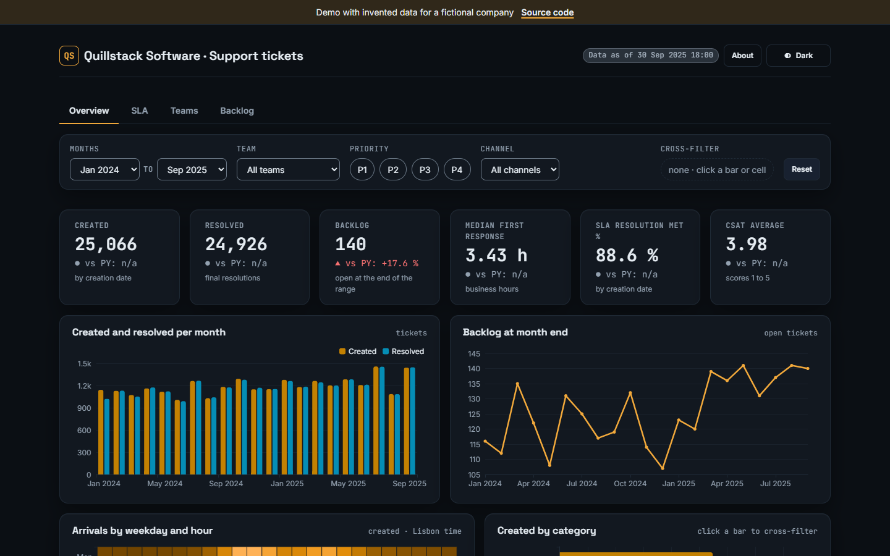
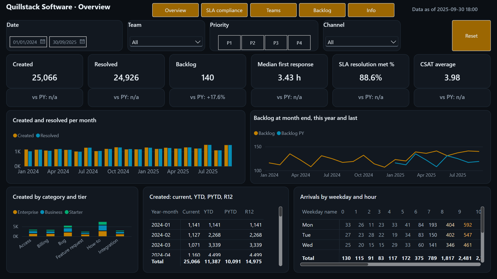
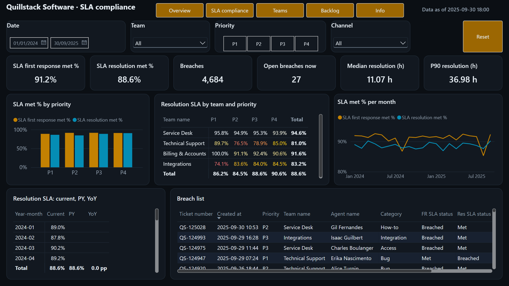
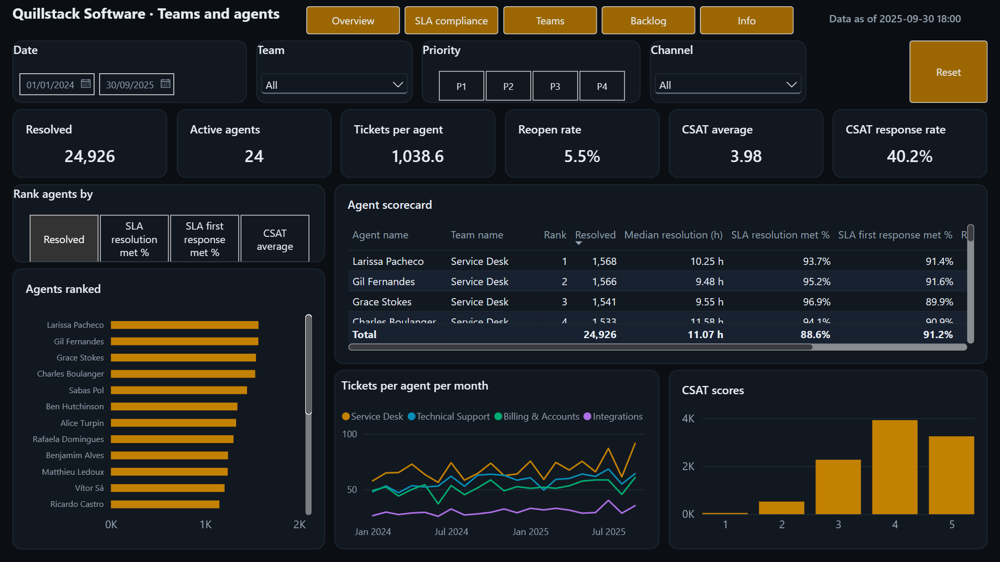
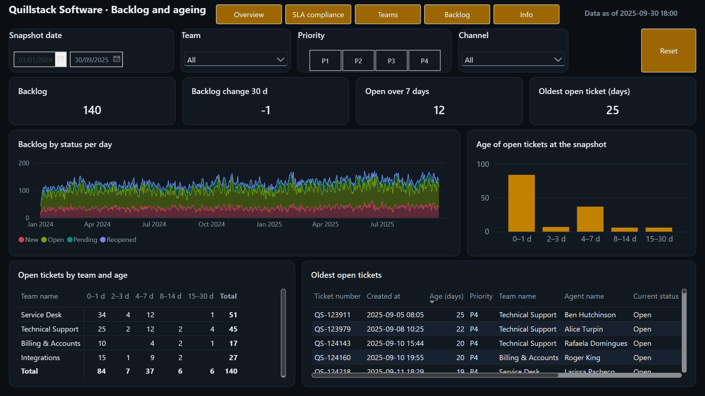
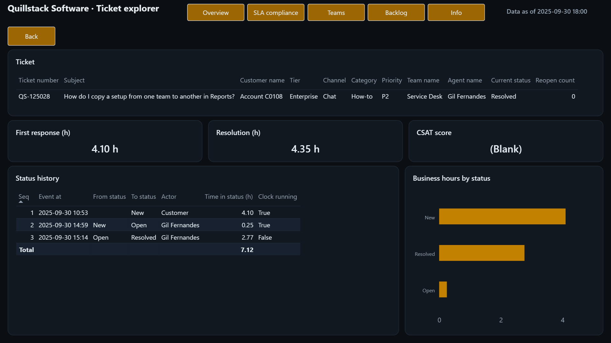
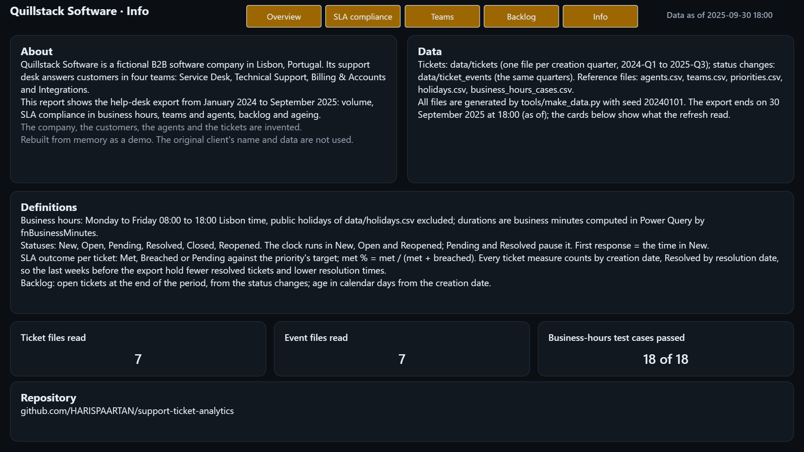
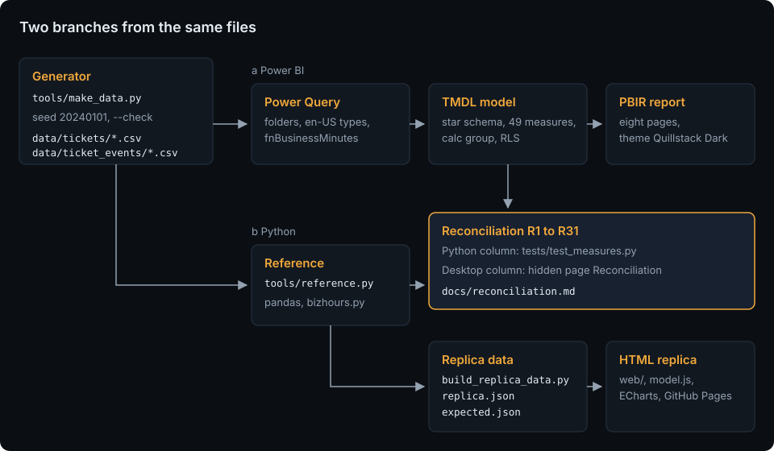
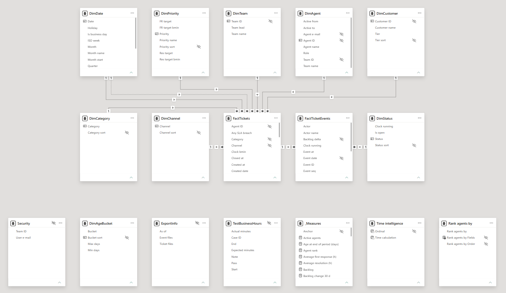

# Support Ticket Analytics

[](https://github.com/HARISPAARTAN/support-ticket-analytics/actions/workflows/ci.yml)
[](https://github.com/HARISPAARTAN/support-ticket-analytics/actions/workflows/pages.yml)
[](https://github.com/HARISPAARTAN/support-ticket-analytics/releases)

Power-BI-Bericht auf dem Export eines Helpdesks: SLA-Einhaltung in Geschäftszeiten, Rückstand und Alter offener Tickets, Teamleistung und Kundenzufriedenheit für ein fiktives B2B-Softwareunternehmen; die Dauern in Geschäftszeiten rechnet Power Query und ein Python-Zwilling prüft sie, 31 Prüfwerte sind gegen eine unabhängige pandas-Berechnung abgeglichen, dazu eine HTML-Nachbildung als Live-Demo.

English: [README.md](README.md)

## Status

- CI am 2026-11-02 für Commit `6f57c00` unter Ubuntu und Windows bestanden: ruff, die Python-Tests mit den Bändern des Generators, die Prüfungen, dass Daten, Nachbildungsdaten und Theme einem frischen Lauf entsprechen, der Scrub, die Filter- und Diagrammtests der Nachbildung, die Werte der Nachbildung, Kontrast, Seitengewicht, die Links und der Kit-Abgleich mit portfolio-kit v0.1.0 ([Lauf](https://github.com/HARISPAARTAN/support-ticket-analytics/actions/runs/41547281040)).
- Die Nachbildung auf GitHub Pages hat am 2026-11-03 die Browserprüfung von `tools/checks/shots.mjs` bestanden: vier Reiter bei 1440 und 390 px in beiden Themes, der Kreuzfilter nach Kategorie, Rank by, die Ticketsuche und Reset, keine Anfrage außerhalb der Seite, kein Konsolenfehler und kein seitliches Scrollen.
- Die Geschäftszeitenfunktion besteht ihre 18 Fälle in Python und bei jeder Aktualisierung in Power Query (die Seite Info zeigt 18 von 18).
- Am 2026-11-03 in Power BI Desktop 2.159.883.0 geprüft: Das Modell lädt die Dateien aus `data/`, alle acht Seiten werden ohne Fehler angezeigt, und alle 31 Abgleichsprüfungen stimmen mit der pandas-Referenz überein, eine davon unter der Rolle `Team lead` ([Abgleich](docs/reconciliation.md)).
- Release v0.1.0 (2026-11-03): [GitHub Releases](https://github.com/HARISPAARTAN/support-ticket-analytics/releases/tag/v0.1.0).

## Kundenauftrag

> Wir sind ein B2B-Softwareunternehmen mit 22 Supportmitarbeitenden in vier Teams. Unser Helpdesk exportiert jedes Quartal die Tickets und ihre Statuswechsel als CSV-Dateien. Wir brauchen auf diesem Export ein Power-BI-Dashboard: Ticketmengen, Zeiten bis zur ersten Antwort und bis zur Lösung in Geschäftszeiten, SLA-Einhaltung nach Priorität, Team und Monat mit einer Liste der Verstöße, den Rückstand und sein Alter, die Leistung der Teams und der Mitarbeitenden sowie die Kundenzufriedenheit. Geschäftszeiten sind Montag bis Freitag 08:00 bis 18:00 Uhr Lissabonner Zeit, ohne Feiertage. Teamleitungen sollen nur ihr eigenes Team sehen.

Rebuilt from memory as a demo. The original client's name and data are not used. (Aus dem Gedächtnis als Demo nachgebaut; Name und Daten des ursprünglichen Kundenunternehmens werden nicht verwendet.) Quillstack Software, Lissabon, ist ein fiktives Unternehmen; Nutzende, Umfang und Abnahmekriterien stehen in [docs/brief.md](docs/brief.md).

## Live-Demo

[harispaartan.github.io/support-ticket-analytics](https://harispaartan.github.io/support-ticket-analytics/)



Die Nachbildung ist eine statische Seite mit vier der Berichtsseiten als Reitern (Overview, SLA, Teams, Backlog), denselben Filtern (Monatsbereich, Team, Priorität, Kanal, Kreuzfilter per Klick auf einen Balken oder eine Matrixzelle, Rank by auf Teams), einer durchsuchbaren Tickettabelle unter den Reitern mit Detaildialog und denselben Regeln wie der Bericht, gezeichnet mit ECharts aus Ticket-Arrays, die die Python-Referenz erzeugt. Sie läuft im Browser ohne Server und sendet keine Daten; die Filter bleiben nur in diesem Browser gespeichert. Nicht enthalten sind der Statusverlauf und die Zeit je Status aus dem Ticket explorer (die Ereignisse werden nicht mitgeliefert), der Rückstand nach Status im Zeitverlauf, die Aufteilung nach Kundenstufe bei den Tickets je Kategorie, die Vorjahreslinie des Rückstands, P90-Zeiten und CSAT satisfied %, die Matrix mit YTD, PYTD und R12 und die Matrix mit Current, PY und YoY, Tagesdaten (die Nachbildung filtert nach Monaten, und das Ende des Bereichs ist der Stichtag des Rückstands), die Rolle `Team lead`, die Tooltip-Seite SLA tooltip, die Lesezeichen (stattdessen eine Schaltfläche Reset) sowie die Seiten Info und Reconciliation.

## Was es kann

Acht Berichtsseiten im Design Quillstack Dark: sieben auf einer Fläche von 1280 × 720 (darunter Reconciliation, in der Leseansicht ausgeblendet) und die Tooltip-Seite SLA tooltip auf 320 × 296, die nicht auf der Fläche liegt, sondern sich über vier Visuals öffnet. Jede Seite außer der Tooltip-Seite hat eine Kopfzeile mit dem Datenstand und Seitenschaltflächen. Die vier Leseseiten mit Slicern (Overview, SLA compliance, Teams and agents, Backlog and ageing) haben eine Slicer-Zeile (Date, auf Backlog and ageing stattdessen ein Stichtag, Team, Priority, Channel, Reset), die über diese Seiten synchronisiert ist, eine Reihe Kennzahlkacheln (auf Overview mit der Veränderung zum Vorjahr) und darunter die Diagramme.

- **Overview**: erstellte und gelöste Tickets, Rückstand, Median der ersten Antwortzeit, SLA-Lösungsquote und CSAT; erstellt und gelöst je Monat; der Rückstand am Monatsende gegenüber dem Vorjahr; erstellt nach Kategorie und Kundenstufe; erstellt als Current, YTD, PYTD und R12; Eingänge nach Wochentag und Stunde.
- **SLA compliance**: Quoten für erste Antwort und Lösung, Verstöße, offene Verstöße, Median und P90 der Lösungszeit; Quoten nach Priorität und je Monat; eine Matrix Team × Priorität, die die Lücke des Teams Integrations bei P1 zeigt; Current gegenüber PY; die Liste der Verstöße.
- **Teams and agents**: Mitarbeitende, gereiht nach der in `Rank agents by` gewählten Kennzahl (gelöste Tickets, eine der SLA-Quoten oder CSAT, ab 20 Tickets), eine Übersicht je Person, Tickets je Person und Monat sowie die CSAT-Bewertungen.
- **Backlog and ageing**: ein Stichtag („am oder vor“), der Rückstand, seine Veränderung in 30 Tagen, Tickets, die länger als 7 Tage offen sind, und das älteste; der Rückstand nach Status je Tag, Altersklassen, eine Matrix Team × Alter und die ältesten offenen Tickets.
- **Ticket explorer**: ein Drill-through aus jeder Tabelle mit Ticketnummer: das Ticket, seine Zeiten und sein Statusverlauf mit den Geschäftsstunden je Status.
- **Info**: was die Demo ist, die Daten und ihre Definitionen sowie das Ergebnis der Geschäftszeiten-Testfälle in Power Query.

| | |
|---|---|
|  |  |
|  |  |
|  |  |

Die ausgeblendete Seite Reconciliation mit ihren 30 Karten: [docs/screenshots/07-reconciliation.png](docs/screenshots/07-reconciliation.png).

Teamleitungen sehen nur ihr Team: Die Rolle `Team lead` filtert über die Anmeldeadresse und die Tabelle `Security`, die aus den Leitungszeilen von `data/agents.csv` entsteht; eine neue Teamleitung ist eine Datenänderung, keine Modelländerung.

## So funktioniert es



Der Generator mit festem Startwert schreibt den Export des Helpdesks: sieben Quartalsdateien mit Tickets, sieben mit Ereignissen und fünf Referenzdateien. Power Query kombiniert die Ordner, berechnet die Geschäftsminuten jedes Statusintervalls mit einer M-Funktion und fasst sie je Ticket zusammen, sodass die Kennzahlen einfache Mediane, Mittelwerte und Zählungen bleiben ([ADR 0001](docs/adr/0001-business-hours-in-power-query.md)); dieselbe Definition steht in `tools/bizhours.py`, und beide sind für dieselben 18 Fälle geschrieben: Python besteht sie in pytest, Power Query bei jeder Aktualisierung (R30 des Abgleichs). Unabhängig davon berechnet `tools/reference.py` die 31 Prüfwerte mit pandas; beide treffen sich im [Abgleich](docs/reconciliation.md), in dem 31 Kennzahlen aus Python und aus Power BI Desktop übereinstimmen müssen. Dieselbe Referenz erzeugt die Daten der Nachbildung. Mehr in [docs/architecture.md](docs/architecture.md).

## Datenmodell

Ein Sternschema: `FactTickets` (eine Zeile je Ticket mit seinen Dauern und SLA-Ergebnissen) und `FactTicketEvents` (eine Zeile je Statuswechsel) mit `DimDate`, `DimPriority` (die SLA-Ziele), `DimTeam`, `DimAgent`, `DimCategory`, `DimChannel`, `DimCustomer` und `DimStatus`; die Altersklassen, die Exportangaben und die Geschäftszeiten-Testfälle in eigenen kleinen Tabellen; 49 Kennzahlen in `_Measures`; die Berechnungsgruppe `Time intelligence` (Current, PY, YoY, YoY %, YTD, PYTD, R12); der Feldparameter `Rank agents by`; die verborgene Tabelle `Security` für die Rolle. Tabellen, Spalten und die Regeln des Generators stehen in [docs/data-model.md](docs/data-model.md), jede Kennzahl mit ihrem DAX in [docs/measures.md](docs/measures.md), die Geschäftszeiten in [docs/business-hours.md](docs/business-hours.md).



## Erste Schritte

Benötigt Python 3.12 mit [uv](https://docs.astral.sh/uv/), Power BI Desktop unter Windows für den Bericht und Node 22 für die Tests der Nachbildung.

```bash
git clone https://github.com/HARISPAARTAN/support-ticket-analytics.git
cd support-ticket-analytics
uv sync
uv run python tools/make_data.py --check      # die Daten entsprechen einem frischen Lauf
uv run pytest -q                               # Python-Tests, Referenz und Offline-Prüfungen des PBIP
node --test "tests/replica/*.test.mjs"         # Filter- und Diagrammcode der Nachbildung
```

`pbip/SupportTicketAnalytics.pbip` in Power BI Desktop öffnen. Start, Daten transformieren, Parameter bearbeiten: `DataFolder` auf den Ordner `data` des eigenen Klons setzen, ohne abschließenden Backslash (Vorgabe `E:\GITGUB\support-ticket-analytics\data`), übernehmen, dann Aktualisieren.

Die Nachbildung lokal mit `uv run python -m http.server -d web 8000` ausliefern und http://127.0.0.1:8000/ öffnen. Aktualisieren, ein neues Quartal, Feiertage und Teamleitungen: [docs/handover.md](docs/handover.md).

## Projektstruktur

```text
data/                erzeugter Export: tickets/ und ticket_events/ (je sieben Quartalsdateien) und fünf CSV-Dateien
pbip/                das Power-BI-Projekt: SupportTicketAnalytics.pbip, .SemanticModel (TMDL), .Report (PBIR, Design)
tools/               make_data.py, bizhours.py, reference.py, build_replica_data.py, sync_kit.py, check_page_weight.py, pbi/, checks/
web/                 die Nachbildung: index.html, assets/ (css, js, data), kit/, vendor/ (ECharts)
tests/               Python-Tests, pbi/ (Offline-Prüfungen des PBIP), replica/ (node --test), fixtures/mini/
docs/                Auftrag, Datenmodell, Geschäftszeiten, Kennzahlen, Architektur, adr/, Übergabe, Desktop-Sitzung, Abgleich, screenshots/
.github/             ci.yml, pages.yml, dependabot.yml
```

## Entscheidungen

- [ADR 0001: Dauern in Geschäftszeiten in Power Query](docs/adr/0001-business-hours-in-power-query.md)
- [ADR 0002: SLA-Ergebnis je Ticket, dem Erstellungsdatum zugeordnet](docs/adr/0002-sla-outcome-per-ticket-by-creation-date.md)
- [ADR 0003: Der Export als Quartalsdateien](docs/adr/0003-quarterly-export-files.md)

Die Entscheidungsdokumente sind auf Englisch.

## Im Vergleich zur ursprünglichen Lieferung

Dieser Nachbau ergänzt:

- einen schriftlichen Auftrag mit Nutzenden, Umfang und Abnahmekriterien sowie ein dokumentiertes Datenmodell mit dem Statusablauf;
- die Geschäftszeitenfunktion, dokumentiert und zweimal umgesetzt, in Power Query und in Python, gegen dieselben 18 Fälle;
- Modell und Bericht als prüfbaren Text (TMDL und PBIR) mit Offline-Lint-Tests und Schemaprüfungen;
- 31 Prüfwerte, gegen eine unabhängige pandas-Referenz abgeglichen, einer davon unter der Rolle für eine Teamleitung;
- einen Paritätstest, der zeigt, dass die Standardwerte der Nachbildung der Referenz entsprechen;
- Übergabenotizen zum Aktualisieren, zum Export eines neuen Quartals, zu Feiertagen, Teamleitungen und einem fehlschlagenden Prüfwert;
- CI unter Ubuntu und Windows mit `uv sync --locked` und festgelegten Actions sowie eine Live-Nachbildung mit getestetem Filtercode.

Der echte Ticketexport des ursprünglichen Kundenunternehmens, der Produktivbetrieb und die Abnahme durch das Kundenunternehmen sind nicht übernommen; die Prüfung in Power BI Desktop ist unter Status und in `docs/reconciliation.md` festgehalten.

## Lizenz und Hinweis zu den Daten

MIT, siehe [LICENSE](LICENSE). Alle Tickets, Kundenkonten, Zahlen und Personen in den Daten erfindet `tools/make_data.py`; Kundenkonten sind Codes, keine Firmennamen. Die Visual-Vorlagen in `tools/pbi/templates/` stammen aus microsoft/fabric-toolbox und die Schemas in `tools/pbi/schemas/` aus microsoft/json-schemas, beide MIT mit erhaltenen Lizenzen; ECharts 5.6.0 steht unter Apache-2.0 (`web/vendor/LICENSE-echarts.txt`); die Schriften in `web/kit/fonts/` stehen unter der SIL Open Font License.

Rebuilt from memory as a demo. The original client's name and data are not used.
