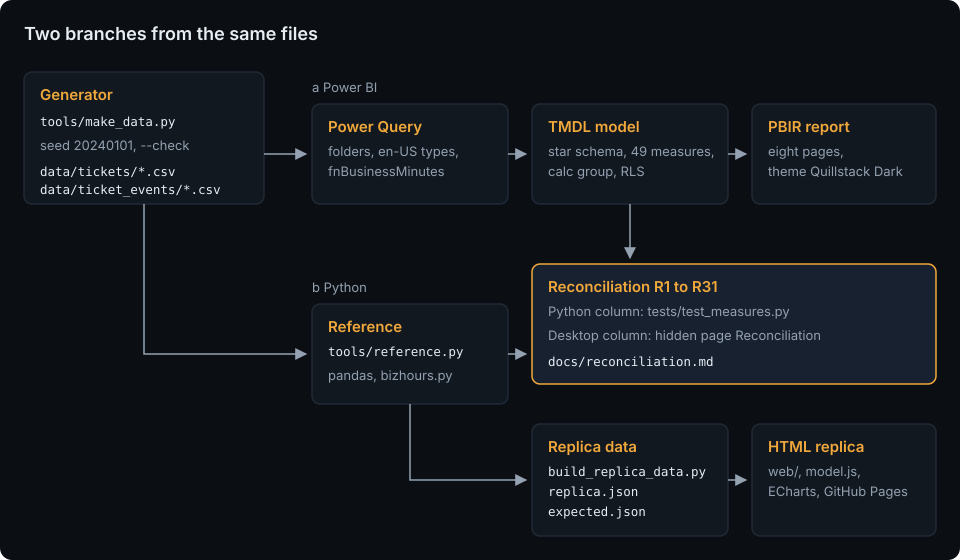

# Support Ticket Analytics

[](https://github.com/HARISPAARTAN/support-ticket-analytics/actions/workflows/ci.yml)
[](https://github.com/HARISPAARTAN/support-ticket-analytics/actions/workflows/pages.yml)
[](https://github.com/HARISPAARTAN/support-ticket-analytics/releases)

Power BI report on a help-desk export: SLA compliance in business hours, backlog and ageing, team performance and CSAT for a fictional B2B software company, with business-hour durations computed in Power Query and tested against a Python twin, 31 headline checks computed independently in pandas for the reconciliation, and a live HTML replica.

Deutsch: [README.de.md](README.de.md)

## Status

- The data files equal a fresh build of `tools/make_data.py`, every band of the generator holds, and the offline checks of the model and the report pass (`uv run pytest`).
- The business-hours function passes its 18 cases in Python; the same cases in Power Query wait for the Desktop session.
- Not yet opened in Power BI Desktop.
- Not released yet.

## Client brief

> We are a B2B software company with 22 support agents in four teams. Our help desk exports tickets and their status changes as CSV files every quarter. We need a Power BI dashboard on that export: ticket volumes, first response and resolution times in business hours, SLA compliance by priority, team and month with a list of breaches, the backlog and how old it is, team and agent performance, and customer satisfaction. Business hours are Monday to Friday 08:00 to 18:00 Lisbon time, public holidays excluded. Team leads should only see their own team.

Rebuilt from memory as a demo. The original client's name and data are not used. Quillstack Software, Lisbon, is a fictional company; users, scope and acceptance criteria are in [docs/brief.md](docs/brief.md).

## Live demo

[harispaartan.github.io/support-ticket-analytics](https://harispaartan.github.io/support-ticket-analytics/)

The replica is a static page with four of the report pages as tabs (Overview, SLA, Teams, Backlog), the same filters (month range, team, priority, channel, a cross-filter by a click on a bar or a matrix cell, Rank by on Teams), a searchable ticket table below the tabs with a detail dialog, and the same rules as the report, drawn with ECharts from ticket arrays that the Python reference builds. It runs in the browser without a server and sends no data anywhere; your filters stay in this browser only. It leaves out the Ticket explorer's status history and time in status (the events are not shipped), the backlog by status over time, the tier split of created by category, the previous-year backlog line, P90 times and CSAT satisfied %, the YTD, PYTD and R12 matrix and the current, PY and YoY matrix, day-level dates (it filters by months, and the end of the range is the backlog snapshot), the role `Team lead`, the SLA tooltip page, the bookmarks (a Reset button instead), and the Info and Reconciliation pages.

## What it does

Eight report pages with the theme Quillstack Dark: seven on a 1280 × 720 canvas (Reconciliation among them, hidden in view mode) and the SLA tooltip page on 320 × 240, which is not on the canvas but opens over four visuals. Every page has a header with the data date and page buttons. The four reading pages with slicers (Overview, SLA compliance, Teams and agents, Backlog and ageing) have a slicer row (Date, on Backlog and ageing a snapshot date instead, Team, Priority, Channel, Reset) synced across them, a row of KPI tiles (on Overview with the change against the previous year), and the charts below.

- **Overview**: created, resolved, backlog, median first response, SLA resolution met % and CSAT; created and resolved per month; the backlog at month end against last year; created by category and tier; created as current, YTD, PYTD and R12; arrivals by weekday and hour.
- **SLA compliance**: first response and resolution met %, breaches, open breaches, median and P90 resolution; met % by priority and per month; a team × priority matrix that shows the Integrations team's P1 gap; current against PY; the breach list.
- **Teams and agents**: agents ranked by the measure picked in `Rank agents by` (resolved, either SLA met % or CSAT, at least 20 tickets), an agent scorecard, tickets per agent per month and the CSAT scores.
- **Backlog and ageing**: a snapshot date ("on or before"), the backlog, its change in 30 days, tickets open over 7 days and the oldest one; the backlog by status per day, age buckets, a team × age matrix and the oldest open tickets.
- **Ticket explorer**: a drill-through from any table with a ticket number: the ticket, its times and its status history with the business hours in each status.
- **Info**: what the demo is, the data and its definitions, and the result of the business-hours test cases in Power Query.

Team leads see only their team: the role `Team lead` filters by the sign-in address through the table `Security`, built from the lead rows of `data/agents.csv`, so a new lead is a data change, not a model change.

## How it works



The seeded generator writes the help desk's export: seven quarterly ticket files, seven quarterly event files and five reference files. Power Query combines the folders, computes the business minutes of every status interval with one M function and groups them per ticket, so the measures stay plain medians, averages and counts ([ADR 0001](docs/adr/0001-business-hours-in-power-query.md)); the same definition lives in `tools/bizhours.py`, and both pass the same 18 cases. Independently, `tools/reference.py` computes every measure with pandas; the two meet in [the reconciliation](docs/reconciliation.md), where 31 headline numbers from Python and from Power BI Desktop must match. The same reference builds the replica's data. More in [docs/architecture.md](docs/architecture.md).

## Data model

A star schema: `FactTickets` (one row per ticket with its durations and SLA outcomes) and `FactTicketEvents` (one row per status change) with `DimDate`, `DimPriority` (the SLA targets), `DimTeam`, `DimAgent`, `DimCategory`, `DimChannel`, `DimCustomer` and `DimStatus`; the age buckets, the export facts and the business-hours test cases in small tables of their own; 49 measures in `_Measures`; the calculation group `Time intelligence` (Current, PY, YoY, YoY %, YTD, PYTD, R12); the field parameter `Rank agents by`; the hidden table `Security` for the role. Tables, columns and the generator rules are in [docs/data-model.md](docs/data-model.md), every measure with its DAX in [docs/measures.md](docs/measures.md), the business hours in [docs/business-hours.md](docs/business-hours.md).

## Getting started

Needs Python 3.12 with [uv](https://docs.astral.sh/uv/), Power BI Desktop on Windows for the report, and Node 22 for the replica tests.

```bash
git clone https://github.com/HARISPAARTAN/support-ticket-analytics.git
cd support-ticket-analytics
uv sync
uv run python tools/make_data.py --check      # the committed data equal a fresh build
uv run pytest -q                               # Python tests, the reference and the offline checks of the PBIP
node --test "tests/replica/*.test.mjs"         # the replica's filter and chart code
```

Open `pbip/SupportTicketAnalytics.pbip` in Power BI Desktop. Home, Transform data, Edit parameters: set `DataFolder` to the `data` folder of your clone without a trailing backslash (the default is `E:\GITGUB\support-ticket-analytics\data`), apply, then Refresh.

Serve the replica locally with `uv run python -m http.server -d web 8000` and open http://127.0.0.1:8000/. Refreshing, a new quarter, holidays and team leads: [docs/handover.md](docs/handover.md).

## Project layout

```text
data/                generated export: tickets/ and ticket_events/ (seven quarterly files each) and five CSV files
pbip/                the Power BI project: SupportTicketAnalytics.pbip, .SemanticModel (TMDL), .Report (PBIR, theme)
tools/               make_data.py, bizhours.py, reference.py, build_replica_data.py, sync_kit.py, check_page_weight.py, pbi/, checks/
web/                 the replica: index.html, assets/ (css, js, data), kit/, vendor/ (ECharts)
tests/               Python tests, pbi/ (offline checks of the PBIP), replica/ (node --test), fixtures/mini/
docs/                brief, data model, business hours, measures, architecture, adr/, handover, desktop session, reconciliation, screenshots/
.github/             ci.yml, pages.yml, dependabot.yml
```

## Decisions

- [ADR 0001: Business-hour durations in Power Query](docs/adr/0001-business-hours-in-power-query.md)
- [ADR 0002: SLA outcome per ticket, attributed to the creation date](docs/adr/0002-sla-outcome-per-ticket-by-creation-date.md)
- [ADR 0003: The export as quarterly files](docs/adr/0003-quarterly-export-files.md)

## Compared with the original delivery

This rebuild adds:

- a written brief with users, scope and acceptance criteria, and a documented data model with the status machine;
- the business-hours function documented and tested twice, in Power Query and in Python, on the same 18 cases;
- the model and the report as reviewable text (TMDL and PBIR) with offline lint tests and schema checks;
- 31 headline checks computed by an independent pandas reference for the reconciliation, one of them under the role for a team lead;
- a parity test that proves the replica's default numbers equal the reference;
- handover notes for refreshing, a new quarter's export, holidays, team leads and a failing check;
- CI on Ubuntu and Windows with `uv sync --locked` and pinned actions, and a live replica with tested filter code.

## Licence and data note

MIT, see [LICENSE](LICENSE). Every ticket, customer account, number and person in the data is invented by `tools/make_data.py`; customer accounts are codes, not company names. The visual templates in `tools/pbi/templates/` come from microsoft/fabric-toolbox and the schemas in `tools/pbi/schemas/` from microsoft/json-schemas, both MIT with their licences kept; ECharts 5.6.0 is Apache-2.0 (`web/vendor/LICENSE-echarts.txt`); the fonts in `web/kit/fonts/` are under the SIL Open Font License.

Rebuilt from memory as a demo. The original client's name and data are not used.
