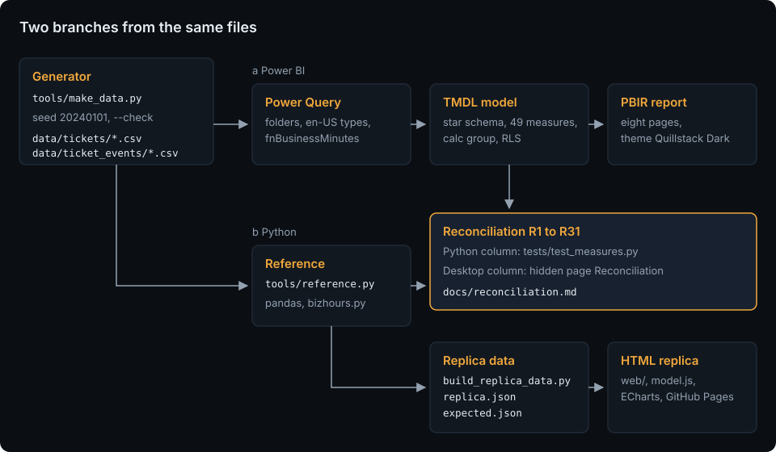

# Architecture

The seeded generator writes the files the help desk would export: seven quarterly ticket files, seven quarterly event files and five reference files. Two branches read them independently:

- **a, Power BI:** Power Query in the PBIP combines the two folders, parses every time with culture en-US and computes the business minutes of every event interval with the M function `fnBusinessMinutes` ([ADR 0001](adr/0001-business-hours-in-power-query.md)); the TMDL model holds the star schema, the 49 measures, the calculation group `Time intelligence`, the field parameter `Rank agents by` and the role `Team lead`; the PBIR report shows eight pages with the theme `Quillstack Dark`.
- **b, Python:** `tools/reference.py` reads the same files with pandas, computes the same durations with `tools/bizhours.py` and every measure with the rules of [the measures](measures.md). `tests/test_measures.py` checks the Python column of the reconciliation table against it; `tools/build_replica_data.py` turns it into `web/assets/data/replica.json` and the 17 expected filter states in `tests/replica/expected.json`.

The branches meet in [the reconciliation table](reconciliation.md): 31 headline numbers, computed by Python and read from Power BI Desktop (the cards of the hidden page Reconciliation and View as for the role), must match. The business-hours function meets its Python twin in the 18 shared cases ([business hours](business-hours.md)).

## Layout

| Path | What it is |
|---|---|
| `data/` | the generated export ([data model](data-model.md)): `tickets/`, `ticket_events/` and five CSV files |
| `pbip/SupportTicketAnalytics.pbip` | the Power BI project; `SupportTicketAnalytics.SemanticModel/` holds the TMDL model and `diagramLayout.json`; `SupportTicketAnalytics.Report/` holds the PBIR report and the theme |
| `tools/make_data.py` | the generator |
| `tools/bizhours.py` | business minutes and their inverse, shared by the generator and the reference |
| `tools/reference.py` | the pandas reference: tickets, events, measures, calculation items, reconciliation values, filter states |
| `tools/build_replica_data.py` | `replica.json` (dimension lists, ticket arrays, the reference block) and `tests/replica/expected.json` |
| `tools/pbi/` | the report generator and the model tools (below) |
| `tools/sync_kit.py` | portfolio-kit's reference script: vendors the kit into `web/kit/` and checks the copy |
| `tools/check_page_weight.py`, `tools/checks/` | page weight, contrast, link check, scrub, the replica's tile check and screenshots |
| `web/` | the replica: `index.html`, `assets/css/app.css`, `assets/js/` (`app.js` for the page, `model.js` for filters and values, `charts.js` for the chart options), `assets/data/replica.json`, `kit/`, `vendor/` (ECharts 5.6.0) |
| `tests/` | Python tests, `pbi/` (offline checks of the PBIP), `replica/` (`node --test`), `fixtures/mini/` |

## Power Query

Parameters: `DataFolder` (the clone's `data` folder, without a trailing backslash), `StartDate` (2024-01-01), `EndDate` (2025-09-30) and `AsOf` (2025-09-30 18:00, equal to `AS_OF` in `tools/reference.py`; a lint test compares them). Helper queries, not loaded: `Holidays`, `HolidayList`, `fnBusinessMinutes`, `TicketFiles` and `EventFiles` (`Folder.Files` on `tickets` and `ticket_events`, `.csv` only, combined in name order) and `EventIntervals` (each event with the next one and the business minutes between them). `FactTickets` groups the intervals per ticket; `FactTicketEvents` loads them. The literal tables `DimCategory`, `DimChannel`, `DimStatus` and `DimAgeBucket` equal the constants of `tools/reference.py` (a lint test compares them).

## The Power BI tooling

`tools/pbi/` is shared with sales-performance-dashboard: every file except `project.json`, `pages.json` and `report_extras.py` is a byte copy of that repository's commit 9dbc4be. The visual templates and the schemas came unchanged from energiewende-monitor; `tests/pbi/test_copied_files.py` checks them against the SHA-256 list `tests/pbi/copied_files.sha256`.

| File | What it does |
|---|---|
| `project.json` | the project's names: PBIP folder, report and model names, the annotation namespace, the theme and the model-view layout |
| `pages.json` | the report as data: canvas, header, slicer rows, sync groups, KPI tiles and the visuals of each page |
| `pbir.py` | PBIR building blocks: visuals from the templates, field references, filters, sync groups, tooltip pages, bookmarks and bookmark buttons; `load_report` and `iter_fields` for the lint tests |
| `build_report.py` | writes the report folder from `pages.json`; run only until the first save in Desktop |
| `report_extras.py` | runs `build_report.py`, then adds what this report needs on top: page buttons, the drill-through binding and its Back button, the hidden page, `NoFilter` interactions (nothing filters a slicer, the heatmap filters nothing) and the text gradients of the two matrices |
| `build_theme.py` | writes the report theme from `web/kit/tokens.css` and the kit palette (`--check` compares instead) |
| `tmdl.py` | a reader for the TMDL subset this model uses, for the lint tests |
| `diagram_layout.py` | writes `diagramLayout.json` for the model view |
| `copy_tom.py` | copies the TOM assemblies into the git-ignored `build/tom/` for the optional parse test |
| `vendor_schemas.py`, `schemas/`, `schema_versions.json` | the pinned PBIR and PBIP JSON schemas (microsoft/json-schemas, MIT) |
| `templates/` | visual templates (microsoft/fabric-toolbox, MIT) and the combo chart template derived from the clustered column chart |

Until the first save in Desktop, `pages.json` and `report_extras.py` are the source of the report and the TMDL files are edited directly. After that save, the files Desktop wrote are the source and the generator is not run again ([desktop session](desktop-session.md)).

## The replica

`web/index.html` is one page with four tabs (Overview, SLA, Teams, Backlog) and hash routes (`#sla`). `model.js` is a pure ES module without DOM access: it decodes the ticket arrays of `replica.json`, applies the filters (month range, team, priorities, channel and a cross-filter) and returns plain values and arrays for each tab with the rules of the reference (median of an even count = the mean of the two middle values); `tests/replica/model.test.mjs` runs it on the 17 states of `tests/replica/expected.json`, which come from the pandas reference over the CSV files, not from the arrays. `charts.js` builds ECharts options from those arrays; `app.js` wires the filter bar, the tabs, the kit's tables and KPI tiles, the ticket table with its search and detail dialog, and the About dialog.

`replica.json` holds one integer array per ticket attribute in ticket id order, no events ([data model](data-model.md)): the created minute (delta-encoded), the packed team, priority, channel, category and status, the agent, the customer, the subject template and module, the first response and resolution business minutes, the first resolution day, the packed outcomes, CSAT and reopen count, and a sparse list of reopen intervals, so the backlog of any day can be rebuilt from the tickets. Its `reference` block holds the four tab views of the default state from `tools/reference.py`; `tests/test_parity.py` compares the block with the reference and a Python reading of the arrays, and `tools/checks/replica-values.mjs` compares every default tile of `model.js` with the block. `replica.json` holds 738,873 bytes (budget 1.3 MB), so the fallback of the spec (tickets of the last twelve months only) is not needed. The page loads 2,034,548 bytes in total, ECharts included (budget 3 MB, `tools/check_page_weight.py`).

What the replica leaves out: the Ticket explorer's status history and time in status (the events are not shipped); backlog by status over time; P90 durations and CSAT satisfied %; YTD, PYTD, R12 and the current, PY and YoY matrix; the role `Team lead`; the SLA tooltip page (ECharts tooltips instead); bookmarks (the Reset button instead); the Info and Reconciliation pages (the About dialog and the README instead). The report is dark only; the replica also follows the light theme of the portfolio.

## CI

`.github/workflows/ci.yml` runs on every push and pull request: job `python` on Ubuntu 24.04 and Windows Server 2025 (lint, format, the lock, all Python tests, `make_data.py --check`, `build_replica_data.py --check`, `build_theme.py --check`, the scrub), job `replica` on Ubuntu (`node --test`, `replica-values.mjs`, contrast, page weight, the offline link check) and job `kit` (portfolio-kit at the pinned tag, `sync_kit.py --check`). `.github/workflows/pages.yml` deploys `web/` to GitHub Pages. Dependabot proposes updates of the actions and of the Python packages, except Faker and numpy feature releases, which would change the data ([handover](handover.md#updating-faker-or-numpy)).
