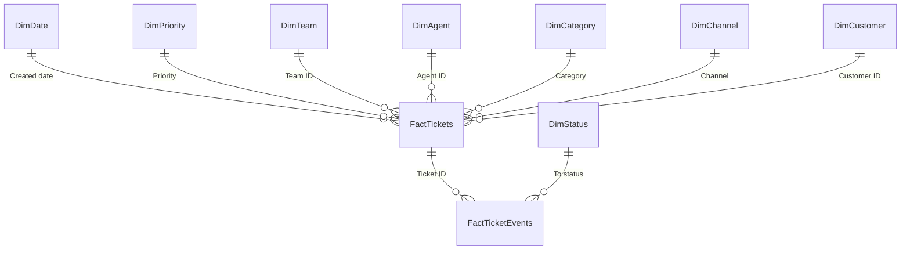

# Data model

The help desk's quarterly export, as the brief describes it: tickets and their status changes, plus the agents, teams, priorities with their SLA targets, the holidays and the business-hours test cases. Everything below is generated by `tools/make_data.py` with seed 20240101 and committed under `data/`; `tests/test_generator.py` holds the rules and the bands, and `tests/pbi/test_tmdl_lint.py` holds the model.

## Files

CSV files are UTF-8 without BOM, LF line endings, comma-separated, ISO dates and `YYYY-MM-DD HH:MM` times (Lisbon wall-clock time, no offset). An empty field is a missing value. Every file is at most 2 MB; the export is split by the ticket's creation quarter ([ADR 0003](adr/0003-quarterly-export-files.md)).

| File | Rows |
|---|---|
| `data/tickets/tickets_2024-Q1.csv` | 3,339 |
| `data/tickets/tickets_2024-Q2.csv` | 3,281 |
| `data/tickets/tickets_2024-Q3.csv` | 3,471 |
| `data/tickets/tickets_2024-Q4.csv` | 3,588 |
| `data/tickets/tickets_2025-Q1.csv` | 3,716 |
| `data/tickets/tickets_2025-Q2.csv` | 3,691 |
| `data/tickets/tickets_2025-Q3.csv` | 3,980 |
| `data/ticket_events/ticket_events_2024-Q1.csv` | 16,340 |
| `data/ticket_events/ticket_events_2024-Q2.csv` | 16,094 |
| `data/ticket_events/ticket_events_2024-Q3.csv` | 16,980 |
| `data/ticket_events/ticket_events_2024-Q4.csv` | 17,634 |
| `data/ticket_events/ticket_events_2025-Q1.csv` | 18,229 |
| `data/ticket_events/ticket_events_2025-Q2.csv` | 18,076 |
| `data/ticket_events/ticket_events_2025-Q3.csv` | 18,716 |
| `data/agents.csv` | 24 |
| `data/business_hours_cases.csv` | 18 |
| `data/holidays.csv` | 28 |
| `data/priorities.csv` | 4 |
| `data/teams.csv` | 4 |

In total 25,066 tickets and 122,069 events. A ticket's events sit in the file of its creation quarter, even when they happen in a later quarter.

### Tickets (`data/tickets/tickets_*.csv`)

| Column | Type | Rule |
|---|---|---|
| `ticket_id` | integer | 100001 upward in creation order |
| `created_at` | time | the arrival model below; 2024-01-01 00:00 to 2025-09-30 17:59 |
| `channel` | text | E-mail, Portal, Chat, Phone |
| `category` | text | Bug, How-to, Billing, Feature request, Access, Integration |
| `priority` | text | P1 to P4 |
| `customer_id`, `customer_name`, `customer_tier` | text | `C0001` to `C0600`; `Account C0001`; Enterprise, Business, Starter |
| `team_id` | integer | 1 to 4, routed by category |
| `agent_id` | integer, empty | assigned at the first response; empty while the ticket is New |
| `subject` | text | one of 48 templates (8 per category) with one of eight Quillstack modules |
| `status` | text | the status at the as-of moment 2025-09-30 18:00 |
| `first_response_at` | time, empty | the second event (the first agent action) |
| `resolved_at` | time, empty | the last Resolved event, set only when `status` is Resolved or Closed |
| `closed_at` | time, empty | the Closed event |
| `reopen_count` | integer | the number of events into Reopened |
| `csat_score` | integer, empty | 1 to 5 |

### Events (`data/ticket_events/ticket_events_*.csv`)

| Column | Type | Rule |
|---|---|---|
| `event_id` | integer | 1 upward, ordered by ticket and sequence |
| `ticket_id` | integer | the ticket |
| `event_seq` | integer | 1 = creation |
| `event_at` | time | non-decreasing within a ticket; none after the as-of moment |
| `from_status` | text, empty | empty for sequence 1 |
| `to_status` | text | the status entered |
| `actor` | text | Customer, Agent, System |
| `agent_id` | integer, empty | set when the actor is an agent |

### Status machine

Statuses: New, Open, Pending, Resolved, Closed, Reopened. New, Open, Pending and Reopened are open (in the backlog). New, Open and Reopened run the resolution clock; Pending (waiting for the customer) and Resolved (waiting for closure or a reopen) pause it; Closed is final.

| From | To | Actor |
|---|---|---|
| (creation) | New | Customer; Agent for Phone tickets |
| New | Open, Pending | Agent (the first response) |
| Open | Pending, Resolved | Agent |
| Pending | Open | Customer (a reply) |
| Resolved | Reopened | Customer, within 7 calendar days |
| Resolved | Closed | System, exactly 7 × 24 h after Resolved when no reopen came |
| Reopened | Pending, Resolved | Agent |

A reopened ticket keeps its id, and the reopened period counts in the backlog and on the clock. A closed ticket never reopens; the customer opens a new ticket. The backlog delta of an event is isOpen(to) − isOpen(from) with isOpen(empty) = 0: +1 at creation and at Resolved to Reopened, −1 at Open or Reopened to Resolved, 0 otherwise.

### Reference files

| File | Columns |
|---|---|
| `data/agents.csv` | `agent_id` (1 to 24), `agent_name` (Faker, locales pt_PT, es_ES, en_GB and fr_FR, seeded), `email` (`first.last@quillstack.example`, ASCII), `team_id`, `role` (Agent, Team lead), `active_from`, `active_to` (empty = active at the export) |
| `data/teams.csv` | `team_id`, `team_name` (Service Desk, Technical Support, Billing & Accounts, Integrations), `lead_agent_id` |
| `data/priorities.csv` | `priority`, `priority_name` (Urgent, High, Normal, Low), `sort_order`, `fr_target_bmin` (60, 240, 480, 1440), `res_target_bmin` (240, 600, 1800, 3000), `fr_target_label` (1 h, 4 h, 8 h, 24 h), `res_target_label` (4 h, 1 d, 3 d, 5 d) |
| `data/holidays.csv` | `date`, `name`, `scope` (National, Lisbon): the Portuguese national holidays of 2024 and 2025 and Lisbon's 13 June |
| `data/business_hours_cases.csv` | `case_id`, `start`, `end`, `expected_minutes` (empty = blank), `note` ([business hours](business-hours.md)) |

Teams: 1 Service Desk (8 agents, 7 at a time), 2 Technical Support (7, 6 at a time), 3 Billing & Accounts (4), 4 Integrations (5). One agent each in teams 1 and 2 leaves on 2025-01-31 and one joins each on 2025-02-01, so 22 work at any time. Each team has one team lead for the whole period.

## Generator

`numpy.random.default_rng(20240101)` draws every number. Faker, pinned to one exact version in `pyproject.toml`, draws only the 24 agent names (seed `NAME_SEED` = 20240101), so a change of the name seed never changes a number. Every lifecycle is simulated to its end; events after the as-of moment are then dropped and the ticket columns are derived from the remaining events. Agent events are placed with `add_business_minutes`, so the business minutes recomputed from the timestamps equal the drawn durations (tested).

- Arrivals: a Poisson count per hour; rate = base × weekday (Monday 1.25 down to Friday 0.85, Saturday 0.12, Sunday 0.08) × hour of day (peak 1.85 at 10:00) × growth (linear from 1.00 in January 2024 to 1.25 in September 2025) × season (August 0.85, 20 to 31 December 0.80) × 0.20 on holidays; the base gives an expected 25,000 tickets.
- Outage days 2024-11-12 and 2025-06-03: Bug arrivals × 4 from 10:00 to 16:00, Bug P1 share × 3, first responses × 1.5.
- Channel: in business hours E-mail 36 %, Portal 30 %, Chat 22 %, Phone 12 %; outside them E-mail 55 %, Portal 45 %.
- Category: Bug 22 %, How-to 30 %, Billing 12 %, Feature request 10 %, Access 14 %, Integration 12 %; Billing × 1.8 on the first three business days of a month (the invoice run).
- Customers: 600 accounts (Enterprise 60, Business 220, Starter 320); ticket share by tier 35, 40 and 25 %; inside a tier the account weight falls with rank to the power −0.8.
- Priority by category (P1/P2/P3/P4 %): Bug 8/27/45/20, Integration 6/24/50/20, Access 3/20/52/25, Billing 0/10/50/40, How-to 0/6/44/50, Feature request 0/0/20/80; Enterprise tickets in Bug, Integration and Access move up one level with probability 0.15.
- Routing: Bug to Technical Support 90 %, Integrations 10 %; Integration to Integrations 90 %, Technical Support 10 %; How-to to Service Desk 85 %, Technical Support 15 %; Access to Billing & Accounts 30 % and to Service Desk otherwise; Billing to Billing & Accounts; Feature request to Service Desk 60 %, Technical Support 40 %.
- Workload: assignment at the first response among the team's active agents not on leave, weight 1.0 for an agent, 0.6 for the team lead, 0.5 in an agent's first 40 business days; four leave blocks of five business days and one of two per agent and year, at most one agent per team on leave on any day; per agent a speed factor lognormal(0, 0.15) and a CSAT offset N(0, 0.2).
- First response (bmin): lognormal with median = target / 3.1 and sigma 0.8; × 1.8 for Integrations P1, × 1.2 in August, × 1.5 on outage days; at most 12,000.
- Resolution clock (bmin in New, Open and Reopened up to the final resolution): lognormal with median = target / 3.6 for P1 and target / 2.9 for P2 to P4, sigma 0.9; for P2 to P4 × category (Bug 1.25, Integration 1.2, Billing 0.9, Feature request 0.8, How-to 0.75, Access 0.6); × 2.2 for Integrations P1; × the agent's speed; at least the first response + 15; at most 36,000.
- Pending: a first cycle with Bug 45 %, Integration 50 %, Billing 40 %, Access 30 %, How-to 25 %, Feature request 10 %, a second with 20 %; the customer replies after lognormal calendar hours (median 20, sigma 1.0, 1 to 240 h).
- Reopen: Bug 9 %, Integration 8 %, Billing 5 %, How-to 4 %, Access 3 %, Feature request 2 %, × 1.5 when the resolution SLA was already breached; a second reopen at 0.15 of that; 2 to 160 calendar hours after Resolved; extra work lognormal (median 45 bmin for P1, 120 otherwise, sigma 0.8).
- CSAT: after the final resolution with probability 40 %, 1 to 72 h later (dropped if after the as-of); score = clip(round(4.2 + the agent's offset − 0.9 if the resolution SLA was breached − 0.6 if reopened + N(0, 0.9)), 1, 5).

## Generator tuning

The bands of `tests/test_generator.py` and the values of the committed data. Seed 20240101 met every band at the first run, so no knob was tuned: the base rate, the median divisors (3.1, 3.6 and 2.9) and the Integrations factors (1.8 and 2.2) are the values above.

| Band | Range | Value |
|---|---|---|
| Tickets | 24,000 to 26,000 | 25,066 |
| Events | 110,000 to 135,000 | 122,069 |
| SLA first response met % | 85 to 95 % | 91.15 % |
| SLA resolution met % | 85 to 95 % | 88.64 % |
| Integrations P1 resolution met % | 55 to 78 % | 74.12 % (first response 77.04 %) |
| Other teams' P1 resolution met % | at least 80 % and 12 points above Integrations | Service Desk 95.79 %, Technical Support 89.74 %, Billing & Accounts 100.0 % (37 tickets) |
| CSAT response rate | 35 to 45 % | 40.16 % |
| CSAT average | 3.9 to 4.4 | 3.98 |

Other values of the committed data: P1 share 3.38 %; 1,382 reopened tickets (5.54 % of the resolved ones); channels E-mail 39.8 %, Portal 33.4 %, Chat 17.6 %, Phone 9.1 %; at the as-of 24,612 tickets are Closed, 314 Resolved, 72 Open, 40 New and 28 Pending.

## Model

The model lives in `pbip/SupportTicketAnalytics.SemanticModel/definition/` (TMDL): import mode, culture en-US, `discourageImplicitMeasures` (required by the calculation group). Hidden columns are marked h. Power Query parses every time with `DateTime.FromText(x, [Format = "yyyy-MM-dd HH:mm", Culture = "en-US"])`, so the locale of the machine does not matter.

| Table | Grain and source | Columns |
|---|---|---|
| `FactTickets` | ticket; `TicketFiles` with the durations and outcomes grouped from `EventIntervals` | `Ticket ID` h, `Ticket number`, `Created at`, `Created date`, `Created hour`, `Channel` h, `Category` h, `Priority` h, `Customer ID` h, `Team ID` h, `Agent ID` h, `Subject`, `Current status` (sorted by `Current status sort`), `Current status sort` h, `First response at`, `Resolved at`, `Resolved date` h, `Closed at`, `Reopen count`, `CSAT score`, `First response bmin`, `Clock bmin`, `Pending bmin`, `Resolution bmin`, `FR SLA status`, `Res SLA status`, `Any SLA breach`, `Ever resolved`, `Is resolved`, `Is open at as-of` |
| `FactTicketEvents` | status change; `EventIntervals` | `Event ID`, `Ticket ID` h, `Event seq`, `Event at`, `Event date` h, `Ticket created date` h, `From status`, `To status`, `Actor`, `Actor name`, `Next event at` h, `Interval bmin`, `Clock running`, `Backlog delta` h |
| `DimDate` | day from `StartDate` to `EndDate`, built in Power Query with `Holidays`; marked as date table on `Date` | `Date`, `Year`, `Quarter`, `Year-quarter`, `Month`, `Month name` (sorted by `Month`), `Year-month` (sorted by `Month start`), `Month start`, `ISO week`, `Weekday`, `Weekday name` (sorted by `Weekday`), `Is business day`, `Holiday` |
| `DimPriority` | priority; `priorities.csv` | `Priority` (sorted by `Priority sort`), `Priority name` (sorted by `Priority sort`), `Priority sort` h, `FR target bmin`, `Res target bmin`, `FR target`, `Res target` |
| `DimTeam` | team; `teams.csv` with the lead's name from `agents.csv` | `Team ID` h, `Team name` (sorted by `Team ID`), `Team lead` |
| `DimAgent` | agent; `agents.csv` plus row 0 `Unassigned` | `Agent ID` h, `Agent name`, `Agent e-mail` h, `Team ID` h, `Team name`, `Role`, `Active from`, `Active to` |
| `DimCategory` | category; M literal table | `Category` (sorted by `Category sort`), `Category sort` h |
| `DimChannel` | channel; M literal table | `Channel` (sorted by `Channel sort`), `Channel sort` h |
| `DimCustomer` | customer account; the distinct customer columns of `TicketFiles` | `Customer ID` h, `Customer name`, `Tier` (sorted by `Tier sort`), `Tier sort` h |
| `DimStatus` | status; M literal table | `Status` (sorted by `Status sort`), `Status sort` h, `Is open`, `Clock running` |
| `DimAgeBucket` | age bucket; M literal table, no relationship | `Bucket` (sorted by `Bucket sort`), `Min days`, `Max days`, `Bucket sort` h |
| `Security` | team lead; the lead rows of `agents.csv`; hidden, no relationship | `User e-mail`, `Team ID` |
| `ExportInfo` | one row; the parameter `AsOf` and the folder listings; hidden | `As of`, `Ticket files`, `Event files` |
| `TestBusinessHours` | test case; `business_hours_cases.csv` with `fnBusinessMinutes`; hidden | `Case ID`, `Start`, `End`, `Expected minutes`, `Actual minutes`, `Pass`, `Note` |
| `_Measures` | the 49 measures ([measures](measures.md)); one hidden anchor column | `Anchor` h |
| `Time intelligence` | calculation group, precedence 1 | `Time calculation` (sorted by `Ordinal`), `Ordinal` h |
| `Rank agents by` | field parameter | `Rank agents by` (sorted by `Rank agents by Order`), `Rank agents by Fields` h (sorted by `Rank agents by Order`), `Rank agents by Order` h |

`EventIntervals` (not loaded) sorts the events by ticket and sequence and merges each event with the next one: the interval ends at the next event, or at `AsOf` for the last event of an open ticket. `Interval bmin` is `fnBusinessMinutes(event at, interval end)`. `FactTickets` groups the intervals per ticket: `First response bmin` is the interval of sequence 1 when a second event exists; `Clock bmin` is the sum of the running intervals; `Pending bmin` the sum of the pending ones; `Resolution bmin` equals `Clock bmin` when the ticket is Resolved or Closed. The SLA statuses follow [ADR 0002](adr/0002-sla-outcome-per-ticket-by-creation-date.md).

Relationships, all many-to-one with single-direction filtering:

| From | To | Active |
|---|---|---|
| `FactTickets[Created date]` | `DimDate[Date]` | yes |
| `FactTickets[Resolved date]` | `DimDate[Date]` | no, `USERELATIONSHIP` in `Resolved` and `Active agents` |
| `FactTickets[Priority]` | `DimPriority[Priority]` | yes |
| `FactTickets[Team ID]` | `DimTeam[Team ID]` | yes |
| `FactTickets[Agent ID]` | `DimAgent[Agent ID]` | yes |
| `FactTickets[Category]` | `DimCategory[Category]` | yes |
| `FactTickets[Channel]` | `DimChannel[Channel]` | yes |
| `FactTickets[Customer ID]` | `DimCustomer[Customer ID]` | yes |
| `FactTicketEvents[Ticket ID]` | `FactTickets[Ticket ID]` | yes |
| `FactTicketEvents[To status]` | `DimStatus[Status]` | yes |

Without a relationship on purpose: the events to `DimDate` (a second path through `FactTickets` would be ambiguous; event measures filter `Event date` explicitly), the events to `DimAgent` (`Actor name` is a column), `DimAgent` to `DimTeam` (`Team name` is merged in), and `Security`, `DimAgeBucket`, `ExportInfo` and `TestBusinessHours`.

The model view in Power BI Desktop: `docs/screenshots/08-model.png` (after the Desktop session).
